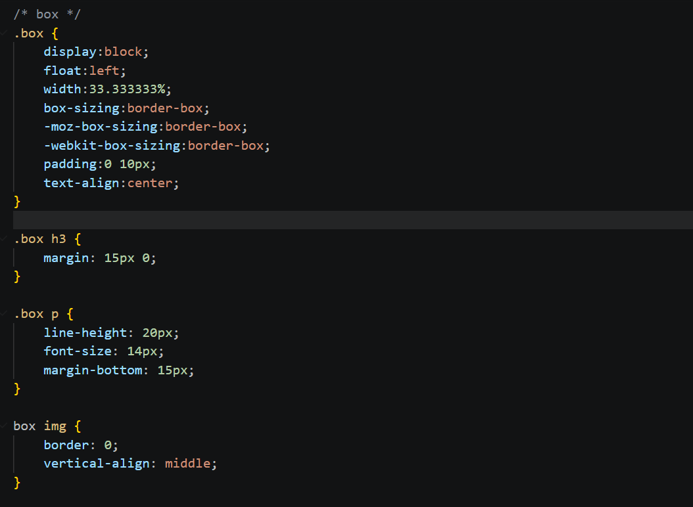

Praktikum 4

Nama : Nabila Eka Suwarno

Kelas : I251C

NIM : 312510399

Screenshot hasil praktikum (lab4_box.html)
# Struktur HTML

# CSS untuk Div 1, Div 2, dan Div 3

# Div 4 dan CSS-nya

Screenshot hasil praktikum (style.css)
# Import Font, Reset CSS, dan Header

# Navigasi dan Hero Panel

# Main Content, Sidebar, Widget, dan Footer

# Box, Row, Divider, dan Entry

# About Page

/

# Contact Page dan Responsive Design

# Tampilan hasil di web lab4web

Screenshot hasil praktikum folder (lab4_layout) file home.html

# Struktur awal HTML, Header, dan Navbar

# Hero section dan tiga kolom konten

# Sidebar dan Footer

# Featurette dengan dua variasi tampilan

Screenshot hasil praktikum folder (lab4_layout) file about.html

# Struktur HTML, Header, dan Navbar

# About Me dan My Skills

# My Portfolio dan Footer

Screenshot hasil praktikum folder (lab4_layout) file kontak.html

# Struktur HTML, Header, dan Navbar

# Judul Kontak dan Formulir

# Tombol Kirim dan Footer

# Tampilan hasil di lab4_layout

